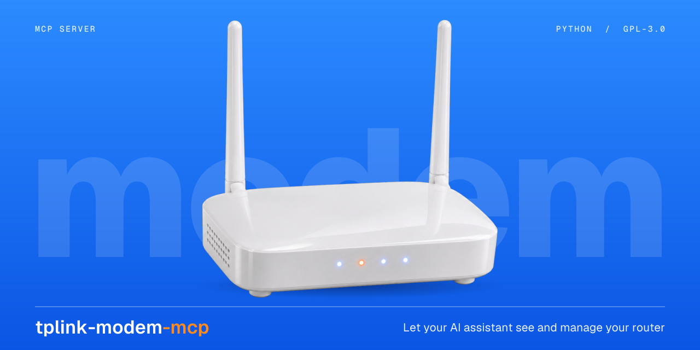

# tplink-modem

A command line and an [MCP](https://modelcontextprotocol.io) server for a TP-Link router or an ISP-supplied TP-Link
modem on your local network, for you, your scripts or your AI agent, so you never have to open its web panel: see who is connected and how strong
their Wi-Fi signal is, give a device a fixed IP, change the Wi-Fi, read the logs, and change anything else the web
panel can. Every change is shown to you first and only applied once you approve it.

[](https://github.com/YakupEmreYerli/tplink-modem/actions/workflows/ci.yml)
[](https://pypi.org/project/tplink-modem/)
[](https://pypi.org/project/tplink-modem/)
[](LICENSE)



[Türkçe](README.tr.md)

It builds on [tplinkrouterc6u](https://github.com/AlexandrErohin/TP-Link-Archer-C6U), so every model that library
supports works. On top of it, it adds a client for older ISP firmwares that library does not detect, for example
the **Archer C5v** that Türk Telekom ships, whose web UI logs in through `/cgi/login?UserName=…&Passwd=…`.

Ask things like:

- "Which devices are on the Wi-Fi right now, and which one has the weakest signal?"
- "The TV keeps dropping off. When did it leave and come back today?"
- "Show me the router's DHCP errors from the last hour."
- "Give the printer a fixed IP, 192.168.1.50."
- "Turn the guest Wi-Fi off." / "Forward port 25565 to my PC."

## Command line

```sh
uv tool install tplink-modem          # or: pipx install tplink-modem
export TPLINK_PASSWORD='<router password>'

tplink-modem status                   # model, internet, Wi-Fi, devices online
tplink-modem clients                  # who is connected, with signal and link rate
tplink-modem find tv
tplink-modem logs --module DHCPD --limit 20
tplink-modem history --hours 6        # who joined and left (see Presence history)
```

Changes show what they would do and stop; add `--confirm` to apply:

```sh
$ tplink-modem static-ip AA:BB:CC:DD:EE:FF 192.168.1.50
would do: reserve 192.168.1.50 for AA:BB:CC:DD:EE:FF
Not applied. Run again with --confirm to apply.

$ tplink-modem static-ip AA:BB:CC:DD:EE:FF 192.168.1.50 --confirm
```

Output is short plain text; `--json` prints the raw result for scripts. `tplink-modem --help` lists every command,
and each one matches an MCP tool below: `read`, `change` and `run` reach any setting the web panel has. Exit codes:
0 done (or previewed), 1 the router or the policy refused, 2 wrong usage.

Agents that can run shell commands can use the command line instead of the MCP server; it costs them far fewer
tokens, since no tool list is loaded up front.

## MCP tools

| Tool | What it does |
| --- | --- |
| `router_status` | Model, firmware, internet connection (status, external IP, uptime), LAN address, Wi-Fi networks, devices online |
| `list_clients` | Devices with hostname, IP, MAC, wired or Wi-Fi band and SSID, signal (dBm) and link rate |
| `find_client` | Search devices by name, IP or MAC |
| `client_history` | Join / leave / IP-change events recorded by this server (routers keep no such log) |
| `wifi_networks` | Every SSID with band, channel and on/off |
| `router_logs` | System log, filtered by module, text or severity |
| `dhcp_leases`, `dhcp_reservations` | DHCP leases and fixed addresses |
| `ipv6_status` | WAN / LAN IPv6 |
| `router_objects` | Every settings object the web panel uses (Wi-Fi, DHCP, port forwarding, firewall, parental control, DNS, QoS, time, ...) and the operations it can run |
| `router_read` | Read any of those objects |
| `set_static_ip`, `remove_static_ip` | Give a device a fixed IP, or take it away |
| `set_wifi` | Change a Wi-Fi network's name, password, on/off, hidden |
| `router_change` | Change, add or delete anything else the web panel can (`set` / `add` / `delete`) |
| `router_run` | Run a router operation such as renewing DHCP or reconnecting PPPoE |
| `reboot_router` | Reboot |

### How changes are approved

A tool that changes the router never does it on the first call. It returns what it would do; the assistant shows
that to you, and only calls again with `confirm=true` once you say yes. If your MCP client can ask you itself
(MCP elicitation), the server also asks you directly before applying. Passwords and keys are masked in everything
the server returns.

`router_objects`, `router_read`, `router_change` and `router_run` work on TP-Link's CGI firmwares: the older ISP
modems and the MR / VR families. On other models the curated tools that tplinkrouterc6u supports still work.

## MCP server

You need [uv](https://docs.astral.sh/uv/) and the router's web admin password. The server has to run on a machine
in the same network as the router.

Claude Code:

```sh
claude mcp add tplink-modem -e TPLINK_PASSWORD='<router password>' -- uvx tplink-modem mcp
```

Claude Desktop, Cursor and other clients that take a JSON config:

```json
{
  "mcpServers": {
    "tplink-modem": {
      "command": "uvx",
      "args": ["tplink-modem", "mcp"],
      "env": { "TPLINK_PASSWORD": "<router password>" }
    }
  }
}
```

From a clone instead of PyPI: `uv --directory /path/to/tplink-modem run tplink-modem mcp`.

This project was called `tplink-modem-mcp` before 0.3.0. The old `tplink-modem-mcp` command still starts the MCP
server, and the old presence history folder keeps being used if it exists.

## Settings

| Variable | Default | |
| --- | --- | --- |
| `TPLINK_PASSWORD` | (required) | web admin password |
| `TPLINK_HOST` | `http://192.168.1.1` | router address |
| `TPLINK_USERNAME` | `admin` | |
| `TPLINK_CLIENT` | auto | `legacy`, or a tplinkrouterc6u class name such as `TPLinkMRClient` |
| `TPLINK_TIMEOUT` | `20` | seconds per request to the router |
| `TPLINK_PRESENCE_INTERVAL` | `60` | seconds between presence samples while the server runs; `0` turns it off |
| `TPLINK_STATE_DIR` | `$XDG_STATE_HOME/tplink-modem` | where the presence history is kept |
| `TPLINK_LOG` | `WARNING` | log level, `DEBUG` shows every router call |
| `TPLINK_WRITE` | `on` | `off` makes the server read-only: change tools are not offered at all |
| `TPLINK_ALLOW` | (all) | comma-separated objects or operations that may be changed, `*` matches a suffix, e.g. `LAN_DHCP*,LAN_WLAN` |
| `TPLINK_DENY` | (none) | objects or operations that may never be changed, e.g. `ACT_FACTORY_RESET,USER_CFG` |
| `TPLINK_SHOW_SECRETS` | `0` | `1` shows Wi-Fi passwords and keys in reads instead of `***` |

Nothing is narrowed by default: the assistant can change whatever the web panel can, always with your approval.
Narrow it when you want to, for example `TPLINK_ALLOW=LAN_DHCP_STATIC_ADDR,LAN_WLAN` for fixed IPs and Wi-Fi only.

TP-Link routers allow one admin session at a time. Calls go through a single shared session, and the legacy
client keeps its login for two minutes, so the web UI may ask you to take over the session while the server is in
use.

## Presence history

Routers do not remember when a device came and went, so the server samples the client list once a minute and
writes join, leave and IP-change events to `presence.jsonl` in the state folder. It only samples while it runs.

For a history around the clock, run `tplink-modem sample` every minute from a timer on a machine that stays
on, and start the MCP server with `TPLINK_PRESENCE_INTERVAL=0` so only the timer writes:

```sh
* * * * * TPLINK_PASSWORD=... uvx tplink-modem sample
```

## Tested on

- Archer C5v v1, firmware v1.8 (Türk Telekom), with the legacy client.

Models tplinkrouterc6u supports should work through it. If you try another model, please
[open a model report](https://github.com/YakupEmreYerli/tplink-modem/issues/new?template=model-report.yml),
whether it works or not.

## Security

The password stays in an environment variable and is only sent to the router. Read tools never change anything.
Change tools only preview until they are called again with `confirm=true`, which the server tells the assistant
to do only after you approve; clients with elicitation also ask you directly. `TPLINK_WRITE`, `TPLINK_ALLOW` and
`TPLINK_DENY` limit what can be changed at all. To report a vulnerability, see [SECURITY.md](SECURITY.md).

## Contributing

See [CONTRIBUTING.md](CONTRIBUTING.md).

## Credits

- [tplinkrouterc6u](https://github.com/AlexandrErohin/TP-Link-Archer-C6U) by Alex Erohin (GPL-3.0), which does
  most of the talking to the router; the legacy client extends its MR200 client.
- [MCP Python SDK](https://github.com/modelcontextprotocol/python-sdk) (MIT).
- Fonts in the brand kit: [Geist](https://vercel.com/font) (SIL OFL 1.1).

## License

[GPL-3.0-or-later](LICENSE), because the server extends tplinkrouterc6u, which is GPL-3.0.
