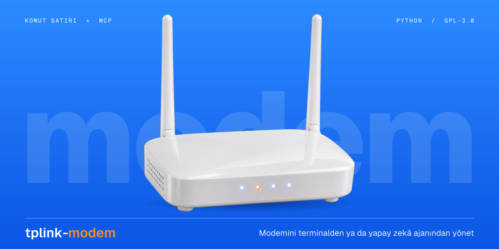

# tplink-modem

Evdeki TP-Link modemi ya da internet sağlayıcısının verdiği TP-Link modemi komut satırından, betiklerinden ya da
yapay zekâ ajanınla yönetmeni sağlayan bir komut satırı aracı ve [MCP](https://modelcontextprotocol.io) sunucusu.
Modemin arayüzünü açmana gerek kalmaz: kimin bağlı olduğunu ve
sinyalini görür, bir cihaza sabit IP verir, Wi-Fi'ı değiştirir, kayıtları okur; arayüzde yapılabilen her şeyi
yapar. Her değişikliği önce sana gösterir, sen onaylamadan uygulamaz.

[](https://github.com/YakupEmreYerli/tplink-modem/actions/workflows/ci.yml)
[](https://pypi.org/project/tplink-modem/)
[](https://pypi.org/project/tplink-modem/)
[](LICENSE)



[English](README.md)

Altta [tplinkrouterc6u](https://github.com/AlexandrErohin/TP-Link-Archer-C6U) kütüphanesini kullanıyor, yani o
kütüphanenin desteklediği her model çalışır. Bunun üstüne, kütüphanenin tanımadığı eski sağlayıcı yazılımları için
ayrı bir istemci ekliyor. Türk Telekom'un verdiği **Archer C5v** buna örnek: arayüzüne
`/cgi/login?UserName=…&Passwd=…` adresinden giriliyor.

Asistana şunları sorabilirsin:

- "Şu an Wi-Fi'da hangi cihazlar var, en zayıf sinyal hangisinde?"
- "Televizyon sürekli kopuyor. Bugün ne zaman düştü, ne zaman geri geldi?"
- "Son bir saatteki DHCP hatalarını göster."
- "Yazıcıya 192.168.1.50 sabit IP'sini ver."
- "Misafir Wi-Fi'ı kapat." / "25565 portunu bilgisayarıma yönlendir."

## Komut satırı

```sh
uv tool install tplink-modem          # ya da: pipx install tplink-modem
export TPLINK_PASSWORD='<modem şifresi>'

tplink-modem status                   # model, internet, Wi-Fi, bağlı cihaz sayısı
tplink-modem clients                  # kim bağlı, sinyali ve hızı ne
tplink-modem find tv
tplink-modem logs --module DHCPD --limit 20
tplink-modem history --hours 6        # kim girdi kim çıktı (bkz. Cihaz geçmişi)
```

Değişiklik yapan komutlar önce ne yapacağını gösterip durur; uygulamak için `--confirm` ekle:

```sh
$ tplink-modem static-ip AA:BB:CC:DD:EE:FF 192.168.1.50
would do: reserve 192.168.1.50 for AA:BB:CC:DD:EE:FF
Not applied. Run again with --confirm to apply.

$ tplink-modem static-ip AA:BB:CC:DD:EE:FF 192.168.1.50 --confirm
```

Çıktı kısa düz metindir; betikler için `--json` ham sonucu basar. `tplink-modem --help` bütün komutları listeler,
her komut aşağıdaki bir MCP aracının karşılığıdır: `read`, `change` ve `run` arayüzdeki her ayara ulaşır. Çıkış
kodları: 0 tamam (ya da önizleme), 1 modem ya da kurallar reddetti, 2 yanlış kullanım.

Komut çalıştırabilen ajanlar MCP sunucusu yerine komut satırını kullanabilir; araç listesi baştan yüklenmediği için
çok daha az token harcar.

## MCP araçları

| Araç | Ne yapar |
| --- | --- |
| `router_status` | Model, yazılım sürümü, internet bağlantısı (durum, dış IP, açık kalma süresi), yerel adres, Wi-Fi ağları, bağlı cihaz sayısı |
| `list_clients` | Cihazların adı, IP'si, MAC adresi, kablolu mu Wi-Fi mı (bant ve ağ adıyla), sinyal (dBm) ve bağlantı hızı |
| `find_client` | Ada, IP'ye ya da MAC adresine göre cihaz arar |
| `client_history` | Bu sunucunun kaydettiği giriş, çıkış ve IP değişikliği olayları (modem böyle bir kayıt tutmaz) |
| `wifi_networks` | Her Wi-Fi ağının bandı, kanalı, açık mı kapalı mı |
| `router_logs` | Sistem kaydı; modüle, metne ya da önem derecesine göre süzülür |
| `dhcp_leases`, `dhcp_reservations` | DHCP kiraları ve sabit adresler |
| `ipv6_status` | WAN ve LAN IPv6 durumu |
| `router_objects` | Modem arayüzünün kullandığı bütün ayar nesneleri (Wi-Fi, DHCP, port yönlendirme, güvenlik duvarı, ebeveyn denetimi, DNS, QoS, saat...) ve çalıştırabileceği işlemler |
| `router_read` | Bu nesnelerden herhangi birini okur |
| `set_static_ip`, `remove_static_ip` | Bir cihaza sabit IP verir ya da kaldırır |
| `set_wifi` | Bir Wi-Fi ağının adını, şifresini, açık/kapalı ve gizli ayarını değiştirir |
| `router_change` | Arayüzde değiştirilebilen her şeyi değiştirir, ekler ya da siler (`set` / `add` / `delete`) |
| `router_run` | DHCP yenileme ya da PPPoE'yi yeniden bağlama gibi bir modem işlemi çalıştırır |
| `reboot_router` | Modemi yeniden başlatır |

### Değişiklikler nasıl onaylanır

Modemi değiştiren bir araç ilk çağrıda hiçbir şey yapmaz, ne yapacağını döndürür. Asistan bunu sana gösterir,
ancak sen evet dersen `confirm=true` ile yeniden çağırır. MCP istemcin sana kendisi soru sorabiliyorsa (MCP
elicitation), sunucu uygulamadan önce ayrıca doğrudan sana da sorar. Sunucunun döndürdüğü her şeyde şifreler ve
anahtarlar gizlenir.

`router_objects`, `router_read`, `router_change` ve `router_run`, TP-Link'in CGI yazılımlı modemlerinde çalışır:
eski sağlayıcı modemleri ve MR / VR aileleri. Öteki modellerde tplinkrouterc6u'nun desteklediği hazır araçlar
yine çalışır.

## MCP sunucusu

[uv](https://docs.astral.sh/uv/) ve modemin arayüz şifresi gerekiyor. Sunucu, modemle aynı ağdaki bir bilgisayarda
çalışmalı.

Claude Code:

```sh
claude mcp add tplink-modem -e TPLINK_PASSWORD='<modem şifresi>' -- uvx tplink-modem mcp
```

Claude Desktop, Cursor ve JSON ayar dosyası kullanan öteki istemciler:

```json
{
  "mcpServers": {
    "tplink-modem": {
      "command": "uvx",
      "args": ["tplink-modem", "mcp"],
      "env": { "TPLINK_PASSWORD": "<modem şifresi>" }
    }
  }
}
```

PyPI yerine indirdiğin kopyadan çalıştırmak için: `uv --directory /yol/tplink-modem run tplink-modem mcp`.

Projenin adı 0.3.0'dan önce `tplink-modem-mcp` idi. Ayarında `uvx tplink-modem-mcp` yazıyorsa `uvx tplink-modem mcp`
olarak değiştir: `tplink-modem-mcp`'nin son sürümü yalnız `tplink-modem`'i kurar, eski `tplink-modem-mcp` komutu da
çalışmaya devam eder. Eski cihaz geçmişi klasörü varsa geçmiş oradan okunur.

## Ayarlar

| Değişken | Varsayılan | |
| --- | --- | --- |
| `TPLINK_PASSWORD` | (zorunlu) | modem arayüzünün şifresi |
| `TPLINK_HOST` | `http://192.168.1.1` | modemin adresi |
| `TPLINK_USERNAME` | `admin` | |
| `TPLINK_CLIENT` | otomatik | `legacy` ya da `TPLinkMRClient` gibi bir tplinkrouterc6u sınıf adı |
| `TPLINK_TIMEOUT` | `20` | modeme giden her istek için saniye |
| `TPLINK_PRESENCE_INTERVAL` | `60` | sunucu açıkken cihaz listesine kaç saniyede bir bakılacağı; `0` kapatır |
| `TPLINK_STATE_DIR` | `$XDG_STATE_HOME/tplink-modem` | cihaz geçmişinin tutulduğu klasör |
| `TPLINK_LOCK_MINUTES` | `60` | üç reddedilen girişten sonra cihazın kaç dakika kilitli kalacağı |
| `TPLINK_LOG` | `WARNING` | kayıt düzeyi; `DEBUG` modeme giden her isteği gösterir |
| `TPLINK_WRITE` | `on` | `off` sunucuyu yalnız okur hâle getirir, değiştiren araçlar hiç görünmez |
| `TPLINK_ALLOW` | (hepsi) | değiştirilebilecek nesne ya da işlemler, virgülle; `*` sonunu tutar, örneğin `LAN_DHCP*,LAN_WLAN` |
| `TPLINK_DENY` | (yok) | hiçbir zaman değiştirilemeyecek nesne ya da işlemler, örneğin `ACT_FACTORY_RESET,USER_CFG` |
| `TPLINK_SHOW_SECRETS` | `0` | `1` okumalarda Wi-Fi şifrelerini ve anahtarları `***` yerine gösterir |

Varsayılan olarak hiçbir şey kısıtlı değil: asistan arayüzde değiştirilebilen her şeyi değiştirebilir, her
seferinde senin onayınla. İstersen daraltırsın; örneğin yalnız sabit IP ve Wi-Fi için
`TPLINK_ALLOW=LAN_DHCP_STATIC_ADDR,LAN_WLAN`.

TP-Link modemler aynı anda tek yönetici oturumuna izin verir. Sunucu bütün istekleri tek bir oturumdan geçirir,
eski tip istemci de girişini iki dakika açık tutar. Bu yüzden sunucu kullanılırken modemin arayüzü oturumu
devralmak isteyip istemediğini sorabilir.

## Birden çok cihaz

Tek router için yukarıdaki ortam değişkenleri yeter. Daha fazlası için routerları
`$XDG_CONFIG_HOME/tplink-modem/devices.toml` dosyasına yazın (ya da `TPLINK_CONFIG` ile başka dosya gösterin):

```toml
[[device]]
name = "upstairs"
host = "192.168.1.1"
default = true          # cihaz adı verilmezse bu kullanılır

[[device]]
name = "garage-ap"
host = "192.168.0.5"
username = "admin"      # isteğe bağlı, varsayılan admin
client = "legacy"       # isteğe bağlı, TPLINK_CLIENT gibi
```

Şifre dosyaya yazılmaz. Her cihaz `TPLINK_PASSWORD_<AD>` değişkenini okur (ad büyük harf, `-` yerine `_`:
`TPLINK_PASSWORD_GARAGE_AP`); varsayılan cihaz düz `TPLINK_PASSWORD`'ü de kabul eder. Dosya yoksa hiçbir şey
değişmez.

```sh
tplink-modem devices                       # ad, adres, varsayılan, kilitli mi
tplink-modem --device garage-ap status
tplink-modem find iphone --all-devices     # bu cihaz hangi routerda?
tplink-modem clients --all-devices
tplink-modem sample --all-devices
```

Her MCP aracı isteğe bağlı `device` alır. Her cihazın kendi geçmişi var. Varsayılan cihaz mevcut geçmiş dosyalarını
(`presence.jsonl`, `last.json`) korur; bu yüzden asıl routerınıza `default = true` yazın. Varsayılan cihazı değiştirmek
geçmişleri takas eder, veri taşınmaz. MCP sunucusunun arka plan örnekleyicisi yalnız varsayılan cihazı kaydeder;
diğerlerini zamanlayıcıda `tplink-modem sample --all-devices` ile kaydedin.

## Üst üste yanlış girişte cihaz kilitlenir

TP-Link birkaç yanlış denemeden sonra yönetici girişini kilitler; sürekli deneyen bir zamanlayıcı kilidi açık
bırakmaz. Router girişi üst üste üç kez reddedince `tplink-modem` o cihazı kilitler ve denemeyi bırakır. Tek bir ret oturum
çakışması olabilir (router aynı anda tek yönetici oturumuna izin verir); bu yüzden yalnız kaç deneme kaldığını
söyler, çalışan bir giriş sayacı sıfırlar. Routerın web arayüzünü tarayıcıda açık bırakmak da bu retlere yol açabilir. Kilitlenince:

```
error: login to http://192.168.1.1 failed earlier; not retrying until the password changes or you run 'tplink-modem unlock upstairs'
```

Kilit, cihazın adresi, kullanıcı adı ya da şifresi değişince kendiliğinden kalkar; bir de
`tplink-modem unlock <cihaz>` ile kaldırılır. Kilit 60 dakika sonra da sona erer (`TPLINK_LOCK_MINUTES`); o zaman
tam bir giriş denenir. Başarısızsa cihaz bir süre daha kilitlenir, başarılıysa sayaç sıfırlanır. En kötü durumda saatte
bir deneme olur. Yalnız reddedilen giriş sayılır; zaman aşımı ya da ulaşılamayan router
ne sayılır ne sıfırlar. Durum dosyasında şifre değil, tuzlu bir özet durur.

## Cihaz geçmişi

Modem, bir cihazın ne zaman gelip gittiğini hatırlamaz. Bu yüzden sunucu dakikada bir cihaz listesine bakar ve
giriş, çıkış ve IP değişikliklerini klasördeki `presence.jsonl` dosyasına yazar. Bunu yalnız açıkken yapar.

Geçmişin gece gündüz tutulması için hep açık duran bir bilgisayarda `tplink-modem sample` komutunu dakikada
bir zamanlayıcıyla çalıştır, MCP sunucusunu da `TPLINK_PRESENCE_INTERVAL=0` ile başlat. Böylece dosyaya yalnız
zamanlayıcı yazar:

```sh
* * * * * TPLINK_PASSWORD=... uvx tplink-modem sample
```

## Denendiği modemler

- Archer C5v v1, yazılım v1.8 (Türk Telekom), eski tip istemciyle.

tplinkrouterc6u'nun desteklediği modellerin onun üzerinden çalışması gerekir. Başka bir modelde denediysen
çalışsa da çalışmasa da bir
[model raporu aç](https://github.com/YakupEmreYerli/tplink-modem/issues/new?template=model-report.yml).

## Güvenlik

Şifre bir ortam değişkeninde durur ve yalnız modeme gönderilir. Okuma araçları hiçbir şeyi değiştirmez.
Değiştiren araçlar `confirm=true` ile yeniden çağrılana kadar yalnız ne yapacaklarını gösterir; sunucu asistana
bunu ancak sen onaylayınca yapmasını söyler, elicitation destekleyen istemciler de sana doğrudan sorar.
`TPLINK_WRITE`, `TPLINK_ALLOW` ve `TPLINK_DENY` neyin değiştirilebileceğini baştan sınırlar. Güvenlik açığı
bildirmek için [SECURITY.md](SECURITY.md) dosyasına bak.

## Katkı

[CONTRIBUTING.md](CONTRIBUTING.md) dosyasında.

## Teşekkür

- Alex Erohin'in [tplinkrouterc6u](https://github.com/AlexandrErohin/TP-Link-Archer-C6U) kütüphanesi (GPL-3.0):
  modemle konuşma işinin çoğunu o yapıyor; eski tip istemci onun MR200 istemcisinin üstüne yazıldı.
- [MCP Python SDK](https://github.com/modelcontextprotocol/python-sdk) (MIT).
- Marka kitindeki yazı tipi: [Geist](https://vercel.com/font) (SIL OFL 1.1).

## Lisans

[GPL-3.0-or-later](LICENSE). Sunucu, GPL-3.0 lisanslı tplinkrouterc6u'yu genişlettiği için bu lisansı taşıyor.
